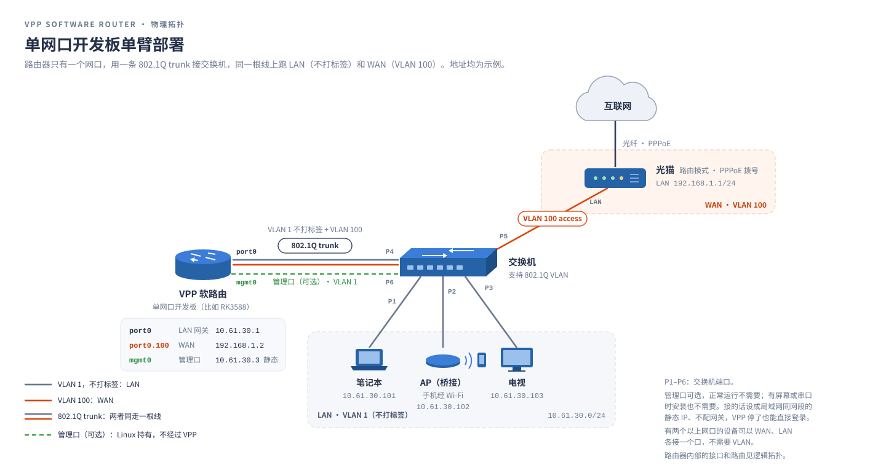
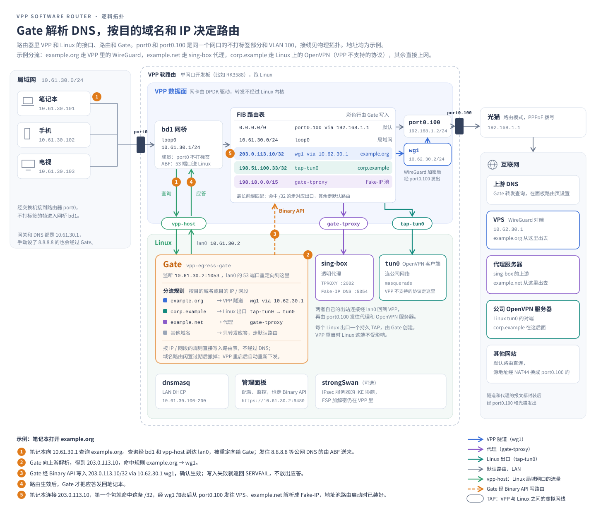

# VPP software router

基于 [VPP](https://fd.io) 和 DPDK 的软路由：VPP/DPDK 补丁、树外插件、从源码安装的脚本、网页管理面板、按域名和目的网段的策略路由，以及配套的测试和压测工具。基于 VPP 26.06、DPDK 26.03。

## 工作原理

一句话概括：VPP 负责转发，Linux 上的服务负责编排，Gate 解析 DNS，按目的域名和目的 IP 决定路由。下面以单网口开发板的单臂部署为例，地址均为示例。

### 物理拓扑



路由器只有一个网口 `port0`，接到支持 VLAN 的交换机的 trunk 口：局域网的帧不打标签，WAN 的帧带 VLAN 100 标签，光猫接在交换机 VLAN 100 的 access 口上。有两个以上网口的设备可以 WAN、LAN 各接一个口，不用 VLAN。

管理口是可选的，正常运行不需要，主要在运行安装脚本时用；有屏幕或串口调试口时也用不着。要接的话（单网口开发板可以用 USB 网卡），它由 Linux 直接持有，不经过 VPP，建议把它接在局域网（VLAN 1）上，设成和局域网同网段的静态 IP（比如 10.61.30.3），不配网关。这样即使 VPP 停了、`lan0` 联系不上，局域网里的电脑也不用改接线、不用改地址，直接 SSH 到这个地址就能登录 Linux。DHCP 只在 `lan0` 上提供，不会在管理口上多出一个 DHCP 服务。

### 逻辑拓扑



`port0` 不打标签的部分加入 VPP 的网桥 `bd1`，局域网 `10.61.30.0/24` 的网关是 `loop0` 的 `10.61.30.1`；子接口 `port0.100` 是 WAN，经光猫上网；另有一条 WireGuard 隧道 `wg1` 连到 VPS。Linux 通过 TAP 接到 VPP：`vpp-host` 是 Linux 在局域网上的接口（`lan0`，`10.61.30.2`），上面运行 Gate、dnsmasq 和管理面板；`gate-tproxy` 和 `tap-tun0` 把流量交给 Linux 上的 sing-box 和 OpenVPN 隧道 `tun0`，VPP 不支持的协议就这样接进来。转发都在 VPP 里完成，只有选了 Linux 出口的流量才进入 Linux。

### Gate：按目的域名和 IP 决定路由

VPP 只能按目的地址选出口，不认识域名。Gate 的规则有两种：按目的 IP 或网段的规则不依赖 DNS，Gate 直接写进 VPP 的路由表；按域名的规则要靠 Gate 自己解析 DNS。局域网的 DNS 查询都交给 Gate（手动设成公网 DNS 的查询由 ABF 送来）。Gate 向上游解析后，如果域名命中规则，先通过 Binary API 把解析出的地址写进 VPP 的路由表，确认生效后才把应答发回客户端；写入失败就返回 SERVFAIL。所以客户端拿到地址时，路由已经就绪，连接的第一个包就会走 `wg1`、代理或 `tun0`，没命中规则的走默认路由出 `port0.100`，路由写入失败的客户端因为无法解析IP直接无法访问。走代理的域名用 Fake-IP，地址池 `198.18.0.0/15` 的路由在启动时就已装好。VPP 重启后，Gate 会重新下发全部路由。

## 开发背景

### Linux 内核网络栈的性能上限

普通软路由用 Linux 内核转发：网卡中断触发 softirq，每个包分配一个 `sk_buff`，依次经过 netfilter、conntrack 和路由查表。每个包的固定开销很大，小包多、连接多时，瓶颈是每秒能处理的包数，而不是带宽：

- GRO、flow offload（SFE 等）主要对大包 TCP 有效，对小包、UDP、新建连接和大量并发会话帮助有限。
- 加 CPU 不能线性提高转发能力。RPS/RSS 会把流量分到多核，但同一条流仍在一个核上，conntrack 查表的缓存未命中也随会话数增加。
- 低功耗 ARM 板子的单核性能和缓存都小，同样的每包开销更早成为瓶颈。

### VPP + DPDK：性能高，但不好用

VPP 在用户态轮询网卡，一次处理一批包（向量处理），按节点图依次处理每一批，指令和数据缓存命中率高，单核就能达到每秒数百万包。代价在易用性、硬件支持和资源占用几方面，和成熟的 OpenWrt 生态相比差距明显：

- **管理方式自成一套，学习负担大**：VPP 只能用自己的 `vppctl` 命令行和 Binary API 控制，用不了 `ip`、`nft`、`uci` 这些熟悉的工具，也没有 LuCI 那样的网页界面，命令语法要去查源码和文档。交给 DPDK 的网卡从内核里消失，Linux 上的工具都看不到，DHCP、DNS 和管理流量要另外接 TAP 回 Linux。配置也不持久：启动时执行一份 CLI 文件，运行中改的地址、NAT 映射、ACL 和路由，VPP 一重启就丢。
- **缺少配套，尤其是基于 DNS 的分流**：OpenWrt 上装个软件包就有的防火墙、端口转发、WireGuard、监控，在 VPP 上都要自己下发、自己保存、重启后自己恢复。OpenWrt 上常用 dnsmasq + ipset/nftset 按域名把流量导到隧道或代理，VPP 没有对应的工具：它的 FIB 表、ACL 和 ABF 只能按地址选出口，没有"这些域名走隧道""这台设备走代理"这类规则，也没法直接和 sing-box 这类代理配合。自己实现的话，要在 DNS 应答之后通过 API 下发路由，还要保证应答释放前路由已经生效、VPP 重启后路由能恢复。
- **网卡支持偏向服务器**：DPDK 的原生驱动主要面向 Intel、Mellanox 这类服务器和数据中心网卡。家用设备和开发板常见的 Realtek 网卡、SoC 板载网卡，驱动很少或者没有，有驱动的也常缺少收包中断这类功能。不支持的网卡只能退回 AF_PACKET，性能会大打折扣。
- **轮询一直占满 CPU**：VPP 默认轮询收包，每个 worker 线程长期占满一个 CPU，CPU 一直运行在最高频率。家用路由大部分时间流量很小，这些 CPU 时间绝大多数都在空转，白白耗电发热。

这个项目要解决的就是这几点：用安装脚本、网页面板和 Gate，让 VPP 软路由用起来接近 OpenWrt；为家用和开发板常见的网卡补上驱动和收包中断；用 worker 休眠让它在轻载时不再空转；同时保留 VPP 的转发性能。

### 硬件支持

**CPU 架构**
- 安装脚本支持 x86_64 和 aarch64。aarch64 只编通用版本，不编 VPP 针对服务器 CPU 的变体（如 `neoversev2`）。
- 大小核：RK3588 的 A55 小核 NAT 能力约为 A76 大核的 1/4，但单个 A55 worker 配合自适应收包已足以满足小型网络的需求，小包转发率要求更高时再把 worker 放到大核上。
- 非一致性 DMA：RK3588 这类 ARM SoC 上，PCIe 网卡的 DMA 不维护缓存一致性，驱动必须自己做缓存维护。上游 r8169 PMD 不做，不能直接用，要换成 `platforms/rtl8125-noncoherent` 里的 PMD。
- 多核扩展：NAT44-EI 按源 IP 选 worker，网卡 RSS 按五元组分队列，单个源 IP 的大量流会频繁跨核转交，多 worker 不一定更快。
- 小内存：内存小于 3 GB 时只编译所选网卡需要的 PMD；更小的设备（比如 1.8 GB 的 N1）只能单线程、不用大页运行。

**网卡**
- 服务器网卡（Intel、Mellanox 等）：DPDK 原生支持，安装脚本把它们排在前面并标为推荐。ConnectX-3（mlx4）需要设备管理的流表（`mlx4_core log_num_mgm_entry_size=-1`），还要关闭 RX scatter 和以太网流控才能达到满速，这些安装脚本都会自动处理。
- Realtek：DPDK 26.03 的 r8169 PMD 支持 RTL8125 和部分 RTL8168 型号；常见的 8111B–F、8411 不支持，只能用 AF_PACKET。
- SoC 板载网卡：很多开发板的板载网卡不是 PCI 设备，DPDK 没有驱动。Phicomm N1 的 DWMAC 用 `platforms/n1-dwmac` 里的原生 PMD 和内核 helper 接入，但这类硬件本身不适合 DPDK，只能当功能验证平台。
- 收包中断：worker 要在轻载时休眠，网卡驱动必须支持收包中断。r8169 和 mlx4 的中断支持来自本项目的补丁，mlx5 还没有打开。VPP 自身也有让 worker 一直轮询的地方，见 [docs/worker-idle.md](docs/worker-idle.md)。


## 实现的功能

**安装**（`deploy/install/vpp-router-install.sh`）
- 检测 CPU、内存、大页、IOMMU 和全部网卡。DPDK 原生支持的网卡优先，不支持的走 AF_PACKET，非 PCI 平台网卡按 `platforms/*/vpp-router.conf` 匹配原生 PMD。
- 下载、打补丁、编译 DPDK 和 VPP。小内存机器自动限制并行数并临时启用 zram。
- 生成 VPP 配置和 systemd 单元，不与发行版的 vpp 软件包冲突。
- 收包方式可选自适应中断：流量小时 worker 休眠，由网卡中断唤醒，CPU 可以降频；流量大时自动转为轮询。r8169、mlx4 和 N1 平台网卡的中断支持来自本项目的补丁。
- WAN 支持 DHCP 或静态地址，出口做 NAT44-EI；LAN 用网桥。支持单臂（VLAN 区分 WAN/LAN）、多网卡和 WAN trunk。
- 可选：dnsmasq 提供 LAN DHCP/DNS（已有系统 dnsmasq 时导入它的配置并替换它），IPv6-PD，IPsec 服务器（strongSwan + VPP），sing-box 代理入口，Gate 策略路由。
- 承载当前 SSH 的网卡交给 VPP 时，可以启用 10 分钟自动回退，没有确认就还原网卡。
- `--restore` 把网卡还给内核，`--uninstall` 删除程序但保留配置。

**管理面板**（`tools/`）

单个静态链接的 Go 程序，不依赖数据库或 Prometheus，低端 ARM 设备也能运行。各项修改同时写入配置文件和运行中的 VPP，VPP 重启后自动恢复。

| 页面 | 内容 |
|---|---|
| 监控 | 接口流量、NAT 会话、VPN 客户端、历史曲线 |
| 接口 | 地址（静态、DHCP、SLAAC、DHCPv6）、VLAN、桥域、MTU，改错 60 秒内不确认就自动回滚 |
| 局域网 | DHCP 地址池和静态分配；按设备列出局域网设备（识别手机的随机 MAC）；可选按设备统计流量（含走代理和 IPv6 的），带历史曲线 |
| 防火墙 | 端口转发（可限制来源）、开放本机端口、IPv6 入站防火墙 |
| WireGuard | 隧道和节点的增删、启停 |
| 系统 | 线程和 CPU 绑定、DPDK 网卡的接入和退出、收包方式和队列分配、NAT 超时和会话表、CPU 调速器 |
| 代理 | sing-box 上游 |
| 路由 | Gate 的分流规则和域名列表 |

**策略路由**（`tools/vpp-egress-gate`，简称 Gate）
- 按域名分流：Gate 转发 DNS 查询，应答命中规则时，先通过 VPP API 下发目的地址路由，路由生效后才把应答发给客户端；失败时返回 SERVFAIL，不会出现"解析到了但流量走错出口"。
- 按目的网段分流，出口可以是 VPP 里的隧道，也可以是 Linux 上的程序（经持久 TAP 连接，比如透明代理、sing-box）。
- 支持 Fake-IP；可选用 ACL/ABF 拦截客户端发往公网 DNS 的查询，手动设置了 DNS 的设备也会经过 Gate。
- VPP 和 Gate 谁先启动都可以，VPP 重启后路由自动重新下发。

**VPP/DPDK 补丁和插件**
- 32 个 VPP 补丁：NAT44-EI 批量查找和若干修复、ACL 缓存、FIB 删除接口时的路径复制、WireGuard 和 IPv6 ND/RA 修复、worker 休眠与唤醒、mlx4 收包中断、多口设备命名等，见 [patches/README.md](patches/README.md)。
- DPDK 补丁：r8169 多队列收包中断；RTL8125 非一致性 DMA PMD 和 RSS 配置。
- 树外插件：NAPT66、NAT 映射域（`nat-ei-context`）、DNS 拦截、WireGuard 与 NAT 的顺序调整、IPsec IKE 转交，以及 strongSwan 的 VPP 后端。

## 性能

完整数据和测试方法见 [docs/benchmarks.md](docs/benchmarks.md)。发包端为 TRex，接收端按序号统计丢包、重复和乱序。

**RK3588 开发板**（RK3588S，一个 A76 worker，单 RX 队列，单臂 2.5G，64B UDP，DDR 固定 2112MHz），饱和转发率，单位 Mpps：

| 路径 | 转发率 |
|---|---:|
| WAN→LAN 静态映射 | 2.14 |
| 动态 SNAT，1 条流 | 1.85–1.87 |
| 动态 SNAT，1 万条流（每包换一条流，缓存最差情况） | 1.51–1.52 |

1518B 大包在 2.5G 线速（约 2.46 Gbps）下零丢包。

**RK3588 开发板单个 A55 小核**：64B 动态 SNAT 1 万流饱和 465 kpps；隧道内吞吐 WireGuard 约 1 Gbps，ESP AES-128-GCM 约 2 Gbps。

**i5-9300H + ConnectX-3**（mlx4，2 worker，64B VLAN 小包，8 个源地址，NAT44-EI）：超载时 7.4–7.9 Mpps。打开 `no-multi-seg` 并关闭以太网流控之前，只有 5.2 Mpps。打开 `no-multi-seg` 后的 7.1 Mpps 与同一网卡上 testpmd 单队列纯收发的结果相同，说明这里的上限在 ConnectX-3 网卡，而不是 CPU 性能不足。

## 安装部署

### 要求

- Debian 或 Ubuntu，x86_64 或 aarch64，root 权限，能访问网络（下载 DPDK、VPP 源码和 Go 工具链）。
- 编译每个并行进程约需 800 MB 内存（含 swap）。内存不够时脚本会减少并行数，小内存设备编译要一个小时以上。
- 至少一个交给 VPP 的网口。单网口时 WAN 和 LAN 用 VLAN 区分（WAN 默认 VLAN 100，LAN 不打标签），需要支持 VLAN 的交换机。
- 不需要额外的管理网口。只有运行安装脚本时（包括之后的重新配置和升级），交给 VPP 的网口会被重新绑定，经过它的 SSH 会断开，这时要从屏幕、串口调试口或一个不交给 VPP 的网口操作。首次安装只能经这个网口 SSH 时，记得启用自动回退。

### 从源码安装

```sh
git clone <本仓库地址> vpp-router && cd vpp-router
sudo deploy/install/vpp-router-install.sh                # 检测、选网卡、编译、安装、配置
sudo deploy/install/vpp-router-install.sh --config-only  # 不编译，只重新配置网卡和地址
sudo deploy/install/vpp-router-install.sh --restore      # 停止 VPP，网卡还给内核驱动
sudo deploy/install/vpp-router-install.sh --uninstall    # 删除程序和服务，保留 /etc/vpp
```

脚本会依次询问：交给 VPP 的网卡，WAN/LAN 分配，WAN 的 DHCP 或静态地址，收包方式（轮询或自适应中断），以及 dnsmasq、IPv6-PD、IPsec、sing-box、Gate 这些可选项。装好后：

- VPP 由 `vpp-router.service` 管理，配置在 `/etc/vpp/`（`router.conf` 是启动参数，`router.vpp` 是启动 CLI），用 `sudo vppctl` 查看状态。
- 管理面板用 HTTPS，默认端口 9480。启用了 Linux 管理 TAP（`vpp-host`）时监听它的地址，否则只监听 `127.0.0.1`，可以用 SSH 端口转发访问。安装结束时脚本会打印实际地址。

面板（9480）、Gate 的 DNS（1053）和 sing-box 的 SOCKS5、TPROXY、Fake-IP DNS（1080、2082、5354）的端口都可以自定义：安装时按提示修改，或者用环境变量指定，比如：

```sh
sudo VPP_PANEL_PORT=8443 VPP_SOCKS_PORT=7890 deploy/install/vpp-router-install.sh
```

所有选项和行为见 [deploy/install/README.md](deploy/install/README.md)，构建参数见 [docs/rebuild.md](docs/rebuild.md)，Gate 的配置见 [tools/vpp-egress-gate/README.md](tools/vpp-egress-gate/README.md)。

### 部署模块

`deploy/` 下的防火墙、IPv6、IPsec、DNS 分流、代理等模块，是从一台单臂设备的实际部署整理出来的。它们用中性名称（`nic0`、`nic1`、`mgmt0`、`vrouter`）和合成地址编写，部署前用私有 profile 渲染成设备上的实际值：

```sh
cp deploy/profiles/example.profile.json ~/mydevice.profile.json   # 编辑，不要放进仓库
python3 deploy/install/stage-source.py /tmp/source --profile ~/mydevice.profile.json
```

详见 [docs/deployment.md](docs/deployment.md)。新装机器用上面的安装脚本即可，不需要这一步。

## 运行过的硬件

| 设备 | 架构 | 内核 | 说明 |
|---|---|---|---|
| RK3588 开发板（RK3588S） | aarch64 | Rockchip vendor 6.1 | RTL8125B 需要 `platforms/rtl8125-noncoherent` |
| Phicomm N1（Amlogic S905D） | aarch64 | 6.18 | 板载网卡需要 `platforms/n1-dwmac` |
| x86_64 主机 | x86_64 | 7.0 | Ubuntu 26.04 |
| i5-9300H 主机 | x86_64 | — | ConnectX-3（mlx4） |

其他网卡和平台能否用 DPDK 原生驱动，安装脚本会在安装时判断，不支持的走 AF_PACKET。代理和 Fake-IP 部分没有内置域名和服务规则，需要自己提供。补丁和部署流程只验证到文档写明的程度，生产使用前请自行测试。

## 目录

| 目录 | 内容 |
|---|---|
| `patches/vpp`、`patches/dpdk` | 对原版 VPP、DPDK 的补丁系列 |
| `plugins` | 树外 VPP 插件和 strongSwan 的 VPP 后端 |
| `platforms` | 硬件相关内容：RTL8125 非一致性 DMA PMD、RK3588 DDR 设置、Phicomm N1 网卡 |
| `deploy/install` | 从源码安装（`vpp-router-install.sh`）和迁移安装（`install.py`） |
| `deploy/*` | 防火墙、IPv6、IPsec、LAN 服务、DNS 分流、代理等部署模块 |
| `tools` | 管理面板、Gate 和各项服务，见 [tools/README.md](tools/README.md) |
| `tests/unit` | 普通 Linux 机器上可运行的测试 |
| `tests/integration` | 需要 root、VPP 或真实设备的测试 |
| `benchmarks` | TRex 压测和性能分析脚本；`benchmarks/history` 是单次实验的脚本 |
| `docs` | 部署、重建、性能和设计文档；`docs/rk3588` 是 RK3588 开发板的专项记录 |
| `build/history`、`docs/history` | 开发过程中的构建脚本和记录，依赖当时的设备，仅供参考 |

## 测试

在 Linux 上运行：

```sh
python3 -m pytest tests/unit
(cd tools/vpp-monitor && go test ./...)   # 每个 Go 模块各自运行
```

`test_vrouter_linux_sequence_capture` 需要 C 编译器和 Linux 头文件。需要 root、VPP 或真实环境的 Go 测试会自动跳过。`tests/integration` 和 `benchmarks` 里的脚本可能改动网络配置，运行前先读脚本并查看 `--help`。

两份 `test_vrouter_*_small_packet_perf.py` 是需要真实设备的独立压测脚本，从环境传入 `CLIENT_IP`、`ROUTER_IP`、`CLIENT_USER`、`ROUTER_USER` 和 `GATEWAY_MAC`。可用 `CLIENT_INTERFACE` 指定发包接口，VPP 压测还可用 `VPP_WAN_INTERFACE` 指定 WAN 计数器接口。

## 许可证

本仓库使用 [Apache-2.0](LICENSE)，以下内容例外：

| 内容 | 许可证 |
|---|---|
| `platforms/rtl8125-noncoherent` 的 DPDK r8169 补丁 | 随原文件，BSD-3-Clause |
| `tools/vpp-monitor/web/uPlot.*` | MIT，见 `uPlot.LICENSE` |

`plugins/strongswan-vpp` 修改的是 VPP 自带的 `vpp_sswan`（Apache-2.0）。构建出的插件由 strongSwan（GPL-2.0-or-later）加载运行，分发编译产物时要同时遵守 strongSwan 的许可证。

## 致谢

本项目建立在这些开源项目之上：

- [VPP](https://fd.io)（FD.io）：转发平面
- [DPDK](https://www.dpdk.org)：用户态网卡驱动
- [GoVPP](https://github.com/FDio/govpp)：面板和 Gate 调用 VPP API
- [sing-box](https://github.com/SagerNet/sing-box)：代理入口和上游
- [strongSwan](https://www.strongswan.org)：IPsec 服务器
- [dnsmasq](https://thekelleys.org.uk/dnsmasq/doc.html)：LAN DHCP/DNS
- [WireGuard](https://www.wireguard.com)：VPN 协议
- [uPlot](https://github.com/leeoniya/uPlot)：面板的图表
- [TRex](https://trex-tgn.cisco.com)：性能测试发包

开发过程中得到了 [Codex](https://openai.com/codex) 和 [Claude Code](https://claude.com/claude-code) 的强力支持。
